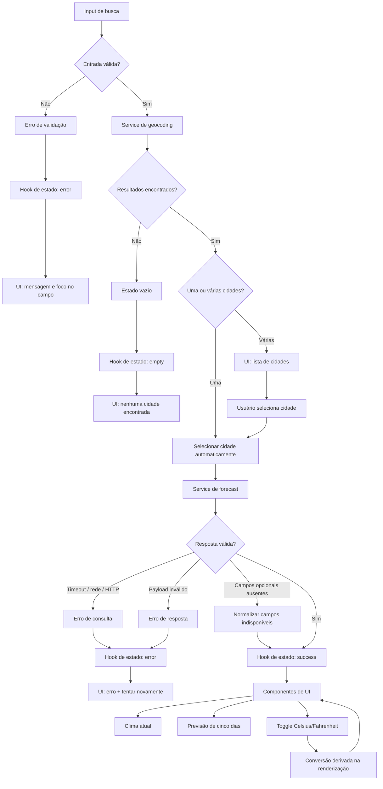

# Plano Técnico — Weather App

## Architecture

A aplicação será uma SPA React com separação simples entre apresentação,
orquestração de estado, regras puras e integração externa.

```text
SearchBar / UnitToggle
          |
          v
       App.tsx  <---- estado de unidade
          |
          v
      useWeather  <---- estado da consulta e cache da sessão
          |
          v
   weatherService  <---- Open-Meteo
          |
          v
  normalize + validate + map
          |
          v
 CurrentWeather / ForecastList / State views
```

### Camadas

- **Presentation:** componentes React responsáveis por formulário, controles,
  clima atual, previsão e estados visuais.
- **Application:** `useWeather` coordena busca, seleção, loading, sucesso,
  vazio, erro, retry e reuso durante a sessão.
- **Domain:** tipos compartilhados e funções puras para conversão, formatação,
  validação e mapeamento dos códigos WMO.
- **Infrastructure:** `weatherService` encapsula URLs, parâmetros, fetch,
  timeout e adaptação das respostas da Open-Meteo.

Os componentes não conhecerão URLs ou o formato bruto da API. A aplicação
trabalhará somente com modelos internos normalizados.

## Tech Stack

- **TypeScript strict:** contratos explícitos e validação de tipos.
- **React:** composição da interface e estado local suficiente para o MVP.
- **Vite:** desenvolvimento, build estático e preview local.
- **Tailwind CSS:** responsividade e estilo visual consistente.
- **Vitest + Testing Library:** testes unitários e de componentes.
- **Playwright:** fluxos E2E nas viewports de referência.
- **Biome:** lint e formatação.
- **pnpm:** instalação e execução padronizada.
- **Open-Meteo:** geocoding e forecast sem API key.
- **GitHub Pages + GitHub Actions:** publicação estática e validação contínua.

Não será introduzida biblioteca de estado global, cliente HTTP ou camada de
backend enquanto o escopo não exigir.

## Project Structure

```text
src/
├── components/
│   ├── states/              # idle, loading, empty e error
│   ├── SearchBar.tsx        # entrada e submit da busca
│   ├── UnitToggle.tsx       # Celsius/Fahrenheit
│   ├── CurrentWeather.tsx   # clima atual
│   ├── ForecastList.tsx     # cinco itens diários
│   └── ForecastCard.tsx     # item individual da previsão
├── hooks/
│   └── useWeather.ts        # orquestração do fluxo da consulta
├── services/
│   └── weatherService.ts    # Open-Meteo, timeout e normalização externa
├── lib/
│   ├── temperature.ts       # conversão e arredondamento
│   ├── format.ts            # pt-BR, datas e unidades
│   └── weatherCodes.ts      # WMO -> descrição e metadados acessíveis
├── types/
│   └── weather.ts           # contratos de domínio
├── styles/
│   └── index.css            # estilos globais e Tailwind
├── App.tsx                  # composição da tela
└── main.tsx                 # bootstrap React

tests/
├── unit/                    # funções, serviços e componentes
├── e2e/                     # fluxos de usuário com Playwright
└── setup.ts                 # configuração compartilhada
```

## Data Model

Os tipos abaixo são contratos; não representam código final.

```ts
type Unit = 'celsius' | 'fahrenheit';

type WeatherStatus = 'idle' | 'loading' | 'success' | 'empty' | 'error';

interface City {
  name: string;
  region?: string;
  country: string;
  latitude: number;
  longitude: number;
}

interface CurrentWeather {
  temperatureCelsius: number;
  apparentTemperatureCelsius: number;
  relativeHumidity: number;
  windSpeedKmh: number;
  precipitationMm: number;
  weatherCode: number;
  observedAt: string;
}

interface DailyForecast {
  date: string;
  minimumCelsius: number;
  maximumCelsius: number;
  weatherCode: number;
}

interface WeatherData {
  city: City;
  timezone: string;
  current: CurrentWeather;
  forecast: DailyForecast[]; // exatamente cinco itens
}

interface WeatherViewState {
  status: WeatherStatus;
  query: string;
  data?: WeatherData;
  error?: WeatherError;
}

type WeatherErrorCode =
  | 'invalid-input'
  | 'geocoding-empty'
  | 'network'
  | 'http'
  | 'timeout'
  | 'invalid-response';

interface WeatherError {
  code: WeatherErrorCode;
  message: string; // mensagem segura em pt-BR
}
```

### Invariantes

- `City.name`, `City.country`, `latitude` e `longitude` são sempre válidos.
- `WeatherData.forecast` contém cinco itens em ordem crescente de data no fuso
  da cidade.
- Temperaturas de domínio permanecem em Celsius; Fahrenheit é apresentação.
- Campos obrigatórios ausentes invalidam a resposta; campos opcionais ausentes
  usam “Indisponível”.
- O cache é indexado por latitude e longitude e vive somente na sessão.

## Data Flow

1. O usuário informa uma cidade; o input remove espaços nas extremidades e
   rejeita vazio ou mais de 100 caracteres sem chamar a rede.
2. `useWeather` muda o estado para `loading` e bloqueia busca concorrente.
3. `weatherService` consulta o endpoint de geocoding.
4. O serviço normaliza resultados válidos em `City` e descarta resultados sem
   nome, país, latitude ou longitude.
5. Nenhum resultado produz `empty`; múltiplos resultados aguardam seleção;
   resultado único é selecionado automaticamente.
6. Para a cidade selecionada, o serviço consulta o forecast com timezone
   automático e dados atuais e diários.
7. O serviço valida o payload, converte-o para `WeatherData` e garante cinco
   itens diários.
8. `useWeather` armazena o sucesso e a chave da localização no cache da sessão.
9. `App` renderiza clima atual e previsão; `UnitToggle` converte somente a
   apresentação.
10. Falhas mapeadas para `WeatherError` encerram loading e permitem retry.



## External APIs

### Geocoding

**Endpoint:** `https://geocoding-api.open-meteo.com/v1/search`

**URL de referência:**

`https://geocoding-api.open-meteo.com/v1/search?name=Lisboa&count=10&language=pt&format=json`

Parâmetros do plano:

- `name`: consulta normalizada.
- `count=10`: limite máximo de resultados exibidos.
- `language=pt`: resposta textual em português quando suportado; a interface
  permanece pt-BR.
- `format=json`.

Parâmetros `current`, `daily` e `timezone` não se aplicam ao geocoding.

Exemplo resumido de resposta:

```json
{
  "results": [
    {
      "name": "Lisboa",
      "admin1": "Lisboa",
      "country": "Portugal",
      "latitude": 38.71667,
      "longitude": -9.13333
    }
  ]
}
```

Mapeamento para `City`:

- `results[].name` -> `City.name`
- `results[].admin1` -> `City.region`
- `results[].country` -> `City.country`
- `results[].latitude` -> `City.latitude`
- `results[].longitude` -> `City.longitude`

Resultados sem `name`, `country`, `latitude` ou `longitude` são descartados.
Uma resposta sem `results` ou com lista vazia produz `geocoding-empty`.

### Forecast

**Endpoint:** `https://api.open-meteo.com/v1/forecast`

**URL de referência:**

`https://api.open-meteo.com/v1/forecast?latitude=38.71667&longitude=-9.13333&timezone=auto&forecast_days=5&current=temperature_2m,apparent_temperature,relative_humidity_2m,wind_speed_10m,precipitation,weather_code&daily=temperature_2m_min,temperature_2m_max,weather_code&temperature_unit=celsius&wind_speed_unit=kmh&precipitation_unit=mm`

Parâmetros do plano:

- `latitude` e `longitude` da cidade selecionada.
- `timezone=auto`.
- `forecast_days=5`.
- `current=temperature_2m,apparent_temperature,relative_humidity_2m,wind_speed_10m,precipitation,weather_code`.
- `daily=temperature_2m_min,temperature_2m_max,weather_code`.
- `temperature_unit=celsius` e `wind_speed_unit=kmh`.
- `precipitation_unit=mm`.

`current` define os campos meteorológicos atuais; `daily` define os campos da
previsão diária; `timezone=auto` faz a API retornar datas no fuso da cidade.

Exemplo resumido de resposta:

```json
{
  "timezone": "Europe/Lisbon",
  "current": {
    "time": "2026-09-30T12:00",
    "temperature_2m": 21.4,
    "apparent_temperature": 21.1,
    "relative_humidity_2m": 58,
    "wind_speed_10m": 12.3,
    "precipitation": 0.0,
    "weather_code": 1
  },
  "daily": {
    "time": ["2026-09-30", "2026-10-01"],
    "temperature_2m_min": [16.2, 15.8],
    "temperature_2m_max": [23.4, 22.9],
    "weather_code": [1, 3]
  }
}
```

Mapeamento para `WeatherData`:

- `timezone` -> `WeatherData.timezone`
- A cidade selecionada no geocoding -> `WeatherData.city`
- `current.time` -> `CurrentWeather.time`
- `current.temperature_2m` -> `CurrentWeather.temperatureCelsius`
- `current.apparent_temperature` -> `CurrentWeather.apparentTemperatureCelsius`
- `current.relative_humidity_2m` -> `CurrentWeather.relativeHumidity`
- `current.wind_speed_10m` -> `CurrentWeather.windSpeedKmh`
- `current.precipitation` -> `CurrentWeather.precipitationMm`
- `current.weather_code` -> `CurrentWeather.weatherCode`

Mapeamento para `ForecastDay` por índice `i`:

- `daily.time[i]` -> `ForecastDay.date`
- `daily.temperature_2m_min[i]` -> `ForecastDay.minimumCelsius`
- `daily.temperature_2m_max[i]` -> `ForecastDay.maximumCelsius`
- `daily.weather_code[i]` -> `ForecastDay.weatherCode`

O serviço deve validar HTTP, JSON, campos obrigatórios, arrays de mesmo tamanho
e exatamente cinco posições diárias antes de retornar `WeatherData`. Os nomes
dos campos externos não atravessam a camada de domínio.

Atribuição visível: link para Open-Meteo com o texto “Dados meteorológicos por
Open-Meteo”.

## State Management

### Ownership

- `App` mantém somente `unit: Unit`, iniciando em `celsius`, porque a unidade
  afeta a apresentação da tela inteira.
- `useWeather` mantém `WeatherViewState`, incluindo `query`, `status`, `data` e
  `error`, porque esses valores pertencem ao fluxo de consulta.
- `weatherService` fornece dados normalizados e mantém o cache da sessão por
  latitude e longitude. O cache não usa `localStorage`, cookies ou servidor.
- Nenhum contexto global ou biblioteca adicional de estado é necessário.

### Estados explícitos

| Estado | Dados esperados | Entrada principal | Saída possível |
|---|---|---|---|
| `idle` | Nenhum resultado; query pode estar vazia. | Abertura da página ou reset. | `loading` após busca válida. |
| `loading` | Query normalizada; dados anteriores podem existir. | Busca ou retry. | `success`, `empty` ou `error`. |
| `success` | `data` completo e `error` ausente. | Resposta válida. | `loading` em nova busca ou `error` em falha posterior. |
| `empty` | Nenhum resultado de geocoding; sem previsão. | Geocoding sem correspondência. | `loading` após nova busca. |
| `error` | `error` presente; dados anteriores podem permanecer. | Rede, API, timeout ou resposta inválida. | `loading` após retry ou nova busca. |

Transições inválidas não devem alterar a tela para um estado intermediário
inconsistente. Uma busca concorrente não é permitida enquanto o status é
`loading`.

### Derivação de unidade

- O domínio e o cache armazenam todas as temperaturas em Celsius.
- `unit` não altera `WeatherData` nem inicia efeitos de rede.
- Na renderização, cada temperatura é convertida somente quando `unit` é
  `fahrenheit`, usando `F = (C × 9/5) + 32`.
- O valor convertido é arredondado para o inteiro mais próximo e recebe o
  sufixo `°F`; Celsius recebe `°C`.
- A mudança de `unit` deve atualizar clima atual e todos os cinco dias usando os
  mesmos dados carregados.

## Error Handling

| Origem | Código | Estado | Comportamento |
|---|---|---|---|
| Input vazio ou acima de 100 caracteres | `invalid-input` | `error` de validação | Não chama API, mantém foco e permite corrigir. |
| Geocoding sem resultados | `geocoding-empty` | `empty` | Informa ausência de cidades e permite nova busca. |
| Falha de DNS, conexão ou rede | `network` | `error` | Sai do loading, mantém dados anteriores e oferece retry. |
| HTTP não sucedido ou rate limit | `http` | `error` | Mensagem segura em pt-BR, sem detalhes da API, e retry. |
| Sem resposta por 5 segundos | `timeout` | `error` | Encerra consulta, informa timeout e oferece retry. |
| JSON inválido ou campo obrigatório ausente | `invalid-response` | `error` | Não exibe payload como válido; preserva dados anteriores. |
| Campo opcional ausente | `partial-response` | `success` | Exibe os demais dados e mostra “Indisponível” no campo afetado. |

Regras adicionais:

- Nenhum erro expõe URL, stack trace, payload ou código interno.
- Campos opcionais ausentes são exibidos como “Indisponível”.
- Um código WMO desconhecido vira “Condição não disponível”.
- Retry usa a última consulta válida sem exigir recarregamento da página.
- A última previsão válida permanece visível quando uma consulta posterior falha.
- O serviço deve validar o corpo antes de alterar o estado para `success`.
- O timeout é de 5 segundos a partir do início da requisição de rede.

## Testing Strategy

### Vitest — funções puras

Testes determinísticos, sem DOM e sem rede, devem cobrir:

- Normalização e validação do input: vazio, espaços, acentos, caracteres
  válidos e limite de 100 caracteres (AC01, AC12).
- Conversão Celsius/Fahrenheit, arredondamento e `0 °C = 32 °F` (AC05).
- Formatação pt-BR, datas no fuso da cidade e unidades `°C`, `°F`, `km/h`, `mm`
  e `%`.
- Mapeamento de todos os códigos WMO suportados e fallback para código
  desconhecido.
- Cálculo da chave de cache por latitude e longitude.

### Vitest — services com mock de fetch

O `fetch` deve ser mockado para manter os testes rápidos e repetíveis. O service
deve ser testado separadamente para:

- URL e parâmetros de geocoding e forecast.
- Normalização de resultados em `City` e descarte de campos obrigatórios
  ausentes.
- Mapeamento de respostas válidas para `WeatherData`, `CurrentWeather` e cinco
  `ForecastDay`.
- Lista de geocoding vazia sem chamada ao endpoint de forecast.
- Erro HTTP, rate limit, falha de rede e timeout de 5 segundos.
- JSON inválido, arrays diários inconsistentes e campos obrigatórios ausentes.
- Campo opcional ausente retornando marcação de indisponibilidade sem invalidar
  os demais dados.

### Vitest + Testing Library — componentes e hook

- Busca por botão e Enter, foco e validação (AC01, AC06, AC12).
- Seleção múltipla e seleção automática de resultado único (AC02).
- Estados `idle`, `loading`, `success`, `empty` e `error` (AC06–AC09).
- Renderização de clima atual, cinco dias e unidades (AC03–AC05).
- Retry preservando a previsão anterior após falha (AC09).
- Reuso da mesma localização sem nova chamada (AC11).
- Controles operáveis por teclado, foco visível, labels e anúncios de estado
  acessíveis (NFR02).

### Playwright — fluxos E2E

Os testes E2E devem validar comportamento integrado, usando interceptação de
rede para respostas determinísticas:

- Busca válida completa: cidade, clima atual e cinco dias.
- Busca por botão e Enter.
- Cidade homônima e seleção do resultado correto.
- Resultado único selecionado automaticamente.
- Input vazio, cidade inexistente e geocoding sem resultados.
- Falha de API, timeout, resposta parcial e retry sem recarregar a página.
- Alternância Celsius/Fahrenheit com verificação de zero nova chamada.
- Estado inicial sem geolocalização ou consulta automática.
- Fluxos de teclado e verificação de nomes acessíveis essenciais.

### Playwright — viewport mobile e qualidade

- Executar os fluxos principais nas viewports `375x667`, `768x1024` e `1440x900`.
- Confirmar ausência de rolagem horizontal, sobreposição e perda de conteúdo.
- Executar nos navegadores suportados pelo projeto.
- Medir 20 execuções por viewport com a API mockada respondendo em até 1
  segundo; pelo menos 19 devem exibir o resultado em até 3 segundos.

### Gates de qualidade

- `pnpm lint`, `pnpm build` e `pnpm test` devem passar antes de concluir uma
  tarefa.
- `pnpm test:e2e` deve passar antes da revisão final.
- Um teste de contrato do adaptador deve confirmar que o mock segue o formato
  esperado da Open-Meteo.

## Risks & Trade-offs

| Decisão | Benefício | Trade-off / risco | Alternativa considerada | Motivo da escolha |
|---|---|---|---|---|
| Estado local em React | Simples e suficiente para uma cidade por vez. | Pode exigir refatoração se surgirem múltiplas telas ou usuários. | Redux ou Zustand. | Evitar dependência e boilerplate sem necessidade no MVP. |
| Open-Meteo direto do cliente | Sem backend, API key ou infraestrutura adicional. | Dependência de disponibilidade, CORS e política da fonte. | Backend proxy ou BFF. | O escopo não exige segredos nem persistência; manter um service isolado. |
| Cache somente na sessão | Reduz chamadas sem persistir dados. | Dados podem ficar desatualizados durante a sessão. | `localStorage` ou cache HTTP persistente. | Respeitar ausência de persistência e manter o comportamento simples. |
| Celsius no domínio | Conversão consistente e sem nova chamada. | Exige cuidado ao formatar todas as temperaturas. | Armazenar a unidade escolhida no domínio. | A unidade é uma preferência de apresentação, não dado meteorológico. |
| Cinco dias diários | Interface simples e comparável. | Não atende usuários que precisam de previsão horária. | Previsão horária ou período configurável. | Atender o MVP definido sem ampliar dados, layout e testes. |
| Mock de API em E2E | Testes determinísticos e rápidos. | Não detecta sozinho mudanças reais no fornecedor. | Usar API real em todos os E2E. | Combinar mocks com um teste de contrato; evitar instabilidade externa. |
| GitHub Pages estático | Deploy simples e baixo custo operacional. | Sem backend, segredos ou observabilidade de runtime. | Hospedagem com backend e monitoramento. | O MVP não exige processamento no servidor; CI cobre qualidade. |
| WCAG 2.2 AA como meta | Reduz risco de exclusão e melhora uso geral. | Exige testes adicionais e atenção a conteúdo dinâmico. | Conformidade apenas parcial. | Acessibilidade é requisito do produto, não um incremento posterior. |